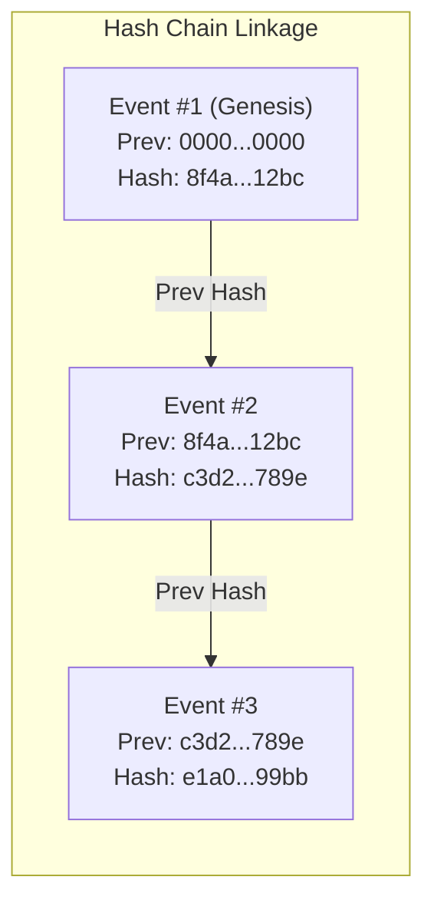

# InfraPulse AI — Stage 13: Enterprise Audit Trail & Vendor Performance Analytics

## 1. Executive Summary

Stage 13 establishes the **Enterprise Audit Trail and Empirical Vendor Performance Analytics Engine** for InfraPulse AI. Prior to Stage 13, system actions, reviews, and quality decisions were logged in localized transactional tables. Stage 13 introduces:
1. **Centralized, Cryptographically Tamper-Evident Audit Logging**: An append-only ledger (`audit_events`) recording every authentication, allocation, conflict check, computer vision inference, quality inspection, corrective action, and financial milestone authorization. Each entry forms an immutable hash chain via SHA-256 cryptography with sequence tracking.
2. **Empirical Vendor Analytics Engine**: Evaluates vendor capabilities strictly from ground-truth database records across 10 empirical KPIs, statistical data sufficiency safeguards, and an explainable weighted scoring model.
3. **Multi-Vendor Benchmark Comparison & Scope-Aware Rankings**: Provides municipal officials with side-by-side performance comparisons, ranking tiers, and project-scoped filters.
4. **Project Analytics & Operational Command Center**: Delivers portfolio-wide situational awareness, work status distributions, simulated financial tracking, and real-time ledger integrity health.
5. **Asynchronous Report Export Engine**: Generates auditable CSV reports with job tracking and instant streaming downloads.

> [!IMPORTANT]
> **Simulated Financial Values**: All invoice, milestone, and payment metrics reflect simulated municipal disbursements. Strict statutory disclaimers are embedded across all database entities, DTOs, frontend views, and exported CSV files.

---

## 2. Enterprise Audit Trail Architecture

### 2.1 Append-Only Audit Event Model

The audit trail is persisted in `audit_events` and governed by `AuditEvent` and `AuditService`. Events are strictly immutable once written.

#### Audit Event Attributes:
- **Event Identifier (`id`)**: UUID primary key.
- **Event Code (`event_code`)**: Human-readable unique code (e.g., `AUD-2026-000001`).
- **Category (`event_category`)**: Partitioned across 8 domain categories:
  - `SECURITY_AUTH`: Logins, token refreshes, unauthorized access attempts.
  - `WORK_ALLOCATION`: Zone assignments, reassignments, vendor acceptances.
  - `CONFLICT_RESOLUTION`: Stage 6 DAG validation, dependency blocks, release overrides.
  - `EVIDENCE_AI`: Photo submissions, EXIF checks, computer vision inference.
  - `QUALITY_INSPECTION`: Inspector reviews, rule validations, checklist sign-offs.
  - `FINANCIAL_WORKFLOW`: Milestone approvals, simulated payment authorizations.
  - `PROJECT_MANAGEMENT`: Project creation, budget revisions, status updates.
  - `SYSTEM_ADMINISTRATION`: Configuration changes, user role updates.
- **Outcome (`outcome`)**: `SUCCESS`, `FAILURE`, `BLOCKED`, `WARNING`.
- **Entity Correlation**: `entity_type`, `entity_id`, `project_id`, `vendor_id`, `work_zone_id`.
- **Actor Metadata**: `actor_id`, `actor_name`, `actor_role`, `client_ip`, `user_agent`, `correlation_id`.
- **Cryptographic Chain Fields**:
  - `chain_scope`: Scope identifier (`GLOBAL` or scoped by project/zone).
  - `sequence_number`: Monotonically incrementing 64-bit integer.
  - `previous_hash`: SHA-256 hash of the preceding event in the chain (`0000000000000000000000000000000000000000000000000000000000000000` for Genesis).
  - `event_hash`: SHA-256 hash computed over canonical event contents.
  - `event_payload`: Sanitized JSON payload snapshotting state changes.



### 2.2 SHA-256 Canonical Hashing Algorithm

The hash of each audit event is generated deterministically by `AuditIntegrityService.calculateEventHash(AuditEvent event, String previousHash)`:

```
Canonical String:
[previousHash]|[eventCode]|[eventType]|[entityType]|[entityId]|[actorId]|[outcome]|[timestampEpochMs]|[sanitizedPayload]
```

This ensures that any modification to the event's actor, action, timestamp, outcome, or payload produces a hash mismatch.

### 2.3 Cryptographic Integrity & Tamper Detection

`AuditIntegrityService` provides automated ledger verification:
- `verifySingleEvent(UUID eventId)`: Recalculates the event's hash from canonical fields and asserts equality against `event_hash`.
- `verifyChain(String chainScope)`: Scans the ordered ledger from sequence 1 through $N$, verifying:
  1. **Strict Sequence Contiguity**: $Seq_i = Seq_{i-1} + 1$.
  2. **Linkage Invariance**: $PrevHash_i = Hash_{i-1}$.
  3. **Content Integrity**: Recalculated hash matches stored `event_hash`.

If any violation occurs, `AuditIntegrityReport` flags the status (`VALID`, `TAMPERED`, `BROKEN_CHAIN`) and catalogs the offending event codes.

---

## 3. Vendor Performance Analytics Engine

The Analytics Engine computes performance metrics strictly from operational database records in `work_assignments`, `photo_evidence`, `quality_inspections`, `corrective_actions`, and `milestone_invoices`.

### 3.1 The 10 Empirical KPIs

| # | KPI Name | Mathematical Formula | Data Source |
|---|---|---|---|
| **1** | **Completion Rate** | $\frac{\text{Approved Completed Assignments}}{\text{Total Assigned \& Eligible}} \times 100$ | `work_assignments` |
| **2** | **On-Time Completion Rate** | $\frac{\text{Approved On-Time Assignments}}{\text{Total Approved Completed}} \times 100$ | `work_assignments.completed_at <= deadline` |
| **3** | **Quality First-Time Pass Rate** | $\frac{\text{Approved First Inspection}}{\text{Total Inspections Conducted}} \times 100$ | `quality_inspections.status = 'APPROVED'` |
| **4** | **Rework Frequency Rate** | $\frac{\text{Assignments with } \ge 1 \text{ Corrective Action}}{\text{Total Completed Assignments}} \times 100$ | `corrective_actions` |
| **5** | **Evidence Compliance Rate** | $\frac{\text{Evidence Submissions with Valid GPS/EXIF}}{\text{Total Evidence Submissions}} \times 100$ | `photo_evidence.gps_verified = true` |
| **6** | **Avg Inspection Turnaround** | $\text{Avg}(\text{inspection\_time} - \text{submission\_time})$ in hours | `quality_inspections` |
| **7** | **Avg Corrective Resolution** | $\text{Avg}(\text{resubmission\_time} - \text{action\_issued\_time})$ in hours | `corrective_actions` |
| **8** | **Overdue Assignments Count** | $\text{Count}(\text{assignments past deadline with status} \neq \text{'APPROVED'})$ | `work_assignments` |
| **9** | **Average Delay Duration** | $\text{Avg}(\text{now} - \text{deadline})$ in days for active overdue items | `work_assignments` |
| **10**| **Simulated Financial Settlement** | $\sum \text{Requested vs Authorized vs Settled Amounts}$ | `milestone_invoices` |

### 3.2 Statistical Data Sufficiency Safeguards

Vendor rankings and composite scores are vulnerable to small-sample bias (e.g., a vendor with 1 completed assignment scoring 100%). To prevent flawed municipal decisions:
- A configurable minimum assignment threshold (default: 5 assignments) is enforced.
- Vendors below the threshold are flagged with `dataSufficiencyStatus = 'INSUFFICIENT_DATA'`.
- The UI renders amber caution badges and displays sample counts transparently (`sampleCounts` map) alongside the score.

### 3.3 Dynamic, Explainable Scoring Framework

Composite scores are computed using `VendorScoringConfigurationService` via configurable weights:

$$\text{Composite Score} = (w_q \cdot \text{Quality}) + (w_t \cdot \text{OnTime}) + (w_e \cdot \text{Evidence}) + (w_r \cdot (100 - \text{Rework})) + (w_c \cdot \text{Completion})$$

Where $\sum w_i = 1.0$.

#### Active Default Weights:
- **Quality Pass Rate**: $0.30$ ($30\%$)
- **On-Time Completion**: $0.25$ ($25\%$)
- **Evidence Compliance**: $0.15$ ($15\%$)
- **Rework Inversion**: $0.15$ ($15\%$)
- **Completion Rate**: $0.15$ ($15\%$)

#### Performance Tiers:
- **Tier 1 (Elite / Excellent)**: Score $\ge 85.0$
- **Tier 2 (Good / Standard)**: $70.0 \le \text{Score} < 85.0$
- **Tier 3 (Needs Improvement)**: $50.0 \le \text{Score} < 70.0$
- **Tier 4 (Critical / Under Review)**: $\text{Score} < 50.0$

Municipal administrators can introduce versioned scoring configurations via `POST /api/v1/analytics/scoring-configs`. When a new configuration is activated, the previous configuration is marked inactive, and an audit event of category `SYSTEM_ADMINISTRATION` is recorded.

---

## 4. Asynchronous Report Export Engine

The platform includes an asynchronous reporting pipeline managed by `ReportExportService`:

### 4.1 Supported Report Types
1. `VENDOR_PERFORMANCE`: Comprehensive vendor KPI scorecards, sample counts, ranking tiers, and compliance metrics.
2. `PROJECT_PERFORMANCE`: Project progress, budgets, active vendors, completion rates, and simulated financial health.
3. `WORK_ASSIGNMENT`: Detailed assignment lifecycle ledger with status, work types, and pin codes.
4. `QUALITY_INSPECTION`: Inspection checklist results, defects identified, and confidence scores.
5. `CORRECTIVE_ACTION`: Remediation tickets, response times, and resolution notes.
6. `AUDIT_EVENT`: Cryptographic audit trail with sequence numbers, hashes, and actor details.
7. `MILESTONE_FINANCIAL`: Simulated disbursement records, milestone percentages, and invoice authorizations.

### 4.2 Report Export Workflow
1. Client issues `POST /api/v1/reports/export` with `reportType`, `format` (`CSV`), and optional filters (`projectId`, `vendorId`, date range).
2. Backend provisions a `ReportJob` entity with `status = 'PENDING'` and begins generation asynchronously.
3. The report is assembled using `ReportExportService`, writing RFC-4180 compliant CSV streams.
4. Upon completion, `status` updates to `'COMPLETED'`, `recordCount` is logged, and a secure download URL is issued.
5. Client downloads the file via `GET /api/v1/reports/jobs/{jobId}/download`.

---

## 5. REST API Reference

### 5.1 Enterprise Audit Trail Endpoints

| Method | Endpoint | Description | Roles |
|---|---|---|---|
| `GET` | `/api/v1/audit-events` | Paginated search of audit events with category/actor/outcome filters | `GOVERNMENT_OFFICIAL`, `ADMIN`, `INSPECTOR` |
| `GET` | `/api/v1/audit-events/{id}` | Retrieve single audit event by ID | `GOVERNMENT_OFFICIAL`, `ADMIN` |
| `GET` | `/api/v1/audit-events/entity/{type}/{id}` | Activity trail for a specific entity | `GOVERNMENT_OFFICIAL`, `ADMIN` |
| `GET` | `/api/v1/projects/{id}/activity` | Paginated audit trail scoped to a project | `GOVERNMENT_OFFICIAL`, `ADMIN` |
| `GET` | `/api/v1/vendors/{id}/activity` | Paginated audit trail scoped to a vendor | `GOVERNMENT_OFFICIAL`, `ADMIN`, `VENDOR` (self) |
| `POST`| `/api/v1/audit-events/integrity/verify`| Run full cryptographic hash chain verification | `GOVERNMENT_OFFICIAL`, `ADMIN` |
| `GET` | `/api/v1/audit-events/integrity/{id}` | Verify single event cryptographic hash | `GOVERNMENT_OFFICIAL`, `ADMIN` |

### 5.2 Analytics & Scoring Endpoints

| Method | Endpoint | Description | Roles |
|---|---|---|---|
| `GET` | `/api/v1/analytics/dashboard/summary` | Operational command center overview | `GOVERNMENT_OFFICIAL`, `ADMIN` |
| `GET` | `/api/v1/analytics/vendors` | Performance scorecards for all vendors | `GOVERNMENT_OFFICIAL`, `ADMIN` |
| `GET` | `/api/v1/analytics/vendors/{id}` | Deep 10-KPI performance breakdown for vendor | `GOVERNMENT_OFFICIAL`, `ADMIN`, `VENDOR` (self) |
| `GET` | `/api/v1/analytics/vendors/rankings` | Tiered vendor rankings with sufficiency flags | `GOVERNMENT_OFFICIAL`, `ADMIN` |
| `GET` | `/api/v1/analytics/vendors/comparison` | Multi-vendor side-by-side benchmark matrix | `GOVERNMENT_OFFICIAL`, `ADMIN` |
| `GET` | `/api/v1/analytics/projects` | Project performance summary across portfolio | `GOVERNMENT_OFFICIAL`, `ADMIN` |
| `GET` | `/api/v1/analytics/projects/{id}` | Detailed project metrics and health indicators | `GOVERNMENT_OFFICIAL`, `ADMIN` |
| `GET` | `/api/v1/analytics/scoring-configs` | List all scoring configurations | `GOVERNMENT_OFFICIAL`, `ADMIN` |
| `GET` | `/api/v1/analytics/scoring-configs/active` | Get active scoring model weights | `GOVERNMENT_OFFICIAL`, `ADMIN` |
| `POST`| `/api/v1/analytics/scoring-configs` | Create new versioned scoring configuration | `ADMIN` |
| `POST`| `/api/v1/analytics/scoring-configs/{id}/activate` | Activate a scoring configuration | `ADMIN` |

### 5.3 Report Export Endpoints

| Method | Endpoint | Description | Roles |
|---|---|---|---|
| `POST`| `/api/v1/reports/export` | Request asynchronous report generation | `GOVERNMENT_OFFICIAL`, `ADMIN` |
| `GET` | `/api/v1/reports/jobs` | Paginated list of generated report jobs | `GOVERNMENT_OFFICIAL`, `ADMIN` |
| `GET` | `/api/v1/reports/jobs/{id}` | Check status and metadata of export job | `GOVERNMENT_OFFICIAL`, `ADMIN` |
| `GET` | `/api/v1/reports/jobs/{id}/download` | Stream generated report file (CSV) | `GOVERNMENT_OFFICIAL`, `ADMIN` |

---

## 6. Frontend Architecture & User Interfaces

The frontend implements a unified, dark-mode design system with rich glassmorphism cards, dynamic filters, and real-time telemetry:

1. **Enterprise Audit Trail Explorer (`/audit-trail`, `/audit-logs`)**:
   - Advanced multi-filter bar (search query, 8 categories, 4 outcomes, date ranges).
   - Live Cryptographic Verification Modal displaying sequence integrity, broken link counts, and hash consistency.
   - Raw JSON Payload Drawer for inspecting cryptographic details (`previousHash`, `eventHash`, `eventPayload`).
2. **Project Activity Log (`/projects/:id/activity`)**:
   - Timeline view of every action, approval, and conflict resolution executed within the project scope.
3. **Vendor Activity Log (`/vendors/:id/activity`)**:
   - Vendor-specific timeline tracking work assignments, submissions, inspections, and rework orders.
4. **Operational Command Center (`/analytics`)**:
   - High-level KPIs: Active projects, total assignments, active vendors, and simulated settled funds.
   - Real-time work status distribution bar.
   - Active scoring framework modal displaying current KPI weights.
   - Live SHA-256 system integrity badge.
5. **Vendor Analytics Directory (`/analytics/vendors`)**:
   - Directory listing all vendors with ranking tier badges, overall scores, and data sufficiency tags.
6. **Vendor Performance Deep-Dive (`/analytics/vendors/:id`)**:
   - 10-KPI analytical breakdown with explainable weighted contribution bars.
   - Sample count diagnostic metrics highlighting underlying data volume.
   - Amber warning card when statistical sufficiency threshold is not met.
   - Clear simulated financial settlement disclaimers.
7. **Multi-Vendor Comparison Matrix (`/analytics/vendor-comparison`)**:
   - Multi-select vendor picker comparing up to 4 vendors side-by-side.
   - Comparative benchmark tables for all 10 KPIs with winner callouts.
8. **Project Performance Analytics (`/analytics/projects`)**:
   - Health status indicators (`HEALTHY`, `AT_RISK`, `DELAYED`).
   - Budget burn rates vs physical completion percentages.
9. **Enterprise Reports Center (`/reports`)**:
   - CSV export generator supporting all 7 report categories.
   - Historical job log with live status chips and one-click downloads.

---

## 7. Verification & Automated Test Coverage

The Stage 13 implementation is verified by comprehensive end-to-end automated test suites across both backend and frontend:

### Backend Test Suite (`com.infrapulse.modules.analytics.AuditAndAnalyticsWorkflowTest`)
- Verified append-only audit event persistence with canonical hash and previous hash linkage.
- Verified single-event and full-chain cryptographic tamper detection.
- Verified simulated tamper mutation causing chain verification to flag invalid hashes.
- Verified empirical calculation of all 10 KPIs from real database records.
- Verified statistical data sufficiency flagging below minimum assignment count.
- Verified versioned scoring configuration creation and activation.
- Verified multi-vendor comparison API responses and project-scoped ranking order.
- Verified asynchronous CSV report generation, job status updates, and download streaming.
- **Backend Test Result**: **124/124 tests passed** (`mvn test`, `BUILD SUCCESS`).

### Frontend Test Suite (`frontend/src/tests/analytics.test.ts`)
- Verified `auditService` query parameter construction, pagination, and cryptographic verification contracts.
- Verified `analyticsService` operational dashboard summary, vendor performance retrieval, and 10-KPI model parsing.
- Verified multi-vendor comparison matrix response handling.
- Verified dynamic scoring configuration retrieval and weight summation.
- Verified report export triggering, job polling, and blob streaming.
- **Frontend Test Result**: **63/63 tests passed across 7 test files** (`vitest run`, exit code 0).
- **Frontend Build**: `tsc && vite build` built cleanly with 0 TypeScript compilation errors.
