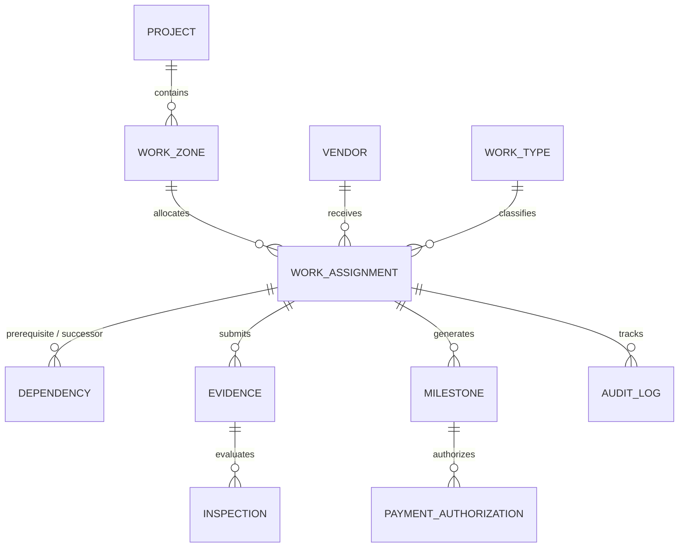

# InfraPulse AI — Database Design Strategy

## 1. Initial Database Strategy
InfraPulse AI adopts an evolutionary schema strategy driven by versioned Flyway migrations.
- **Stage 1 Baseline**: Establishes PostgreSQL 16 connectivity, activates the PostGIS spatial engine, and registers a baseline `system_metadata` table for environment validation.
- **Subsequent Stages**: Incremental migrations will introduce domain entities with strict foreign key integrity, spatial constraints, and indexing.

---

## 2. PostgreSQL & PostGIS Purpose
Infrastructure lifecycle management is fundamentally spatial:
1. **Postal PIN Codes & Municipal Wards**: Work is bounded by municipal administrative boundaries and 6-digit postal codes.
2. **PostGIS Geometry**: Storing spatial coordinates as `GEOMETRY(Polygon, 4326)` allows:
   - Calculating spatial intersections (`ST_Intersects`) between planned trenching routes and road resurfacing polygons.
   - Determining whether two vendors are assigned conflicting work packages within the same physical street parcel.
   - Validating whether uploaded photographic evidence matches the actual coordinates of the work zone (`ST_DWithin(photo_geom, zone_geom, 50 meters)`).

---

## 3. Entity-Relationship Blueprint (Target Architecture)

---

## 4. Planned Entities & Schema Specifications

### 4.1. Projects & Work Zones
- **`projects`**: High-level municipal or infrastructure contract initiatives.
  - `id` (UUID, PK)
  - `name`, `code`, `description`
  - `status` (`DRAFT`, `ACTIVE`, `COMPLETED`, `SUSPENDED`)
  - `start_date`, `target_end_date`
  - `created_at`, `updated_at`

- **`work_zones`**: Geospatial subdivisions mapped to municipal PIN codes.
  - `id` (UUID, PK)
  - `project_id` (UUID, FK -> `projects`)
  - `pin_code` (VARCHAR(10), Indexed)
  - `zone_code`, `zone_name` (e.g., "Ward 104 - Koramangala 5th Block")
  - `boundary_geom` (GEOMETRY(Polygon, 4326), Spatial Index)
  - `center_point` (GEOMETRY(Point, 4326))

### 4.2. Vendors & Work Types
- **`vendors`**: Contracting organizations performing physical construction.
  - `id` (UUID, PK)
  - `company_name`, `registration_no`, `tax_id`
  - `contact_email`, `contact_phone`
  - `status` (`ACTIVE`, `PROBATION`, `SUSPENDED`)
  - `rating_score` (DECIMAL(3, 2))

- **`work_types`**: Standard catalog of physical infrastructure activities.
  - `id` (UUID, PK)
  - `code` (e.g., `TRENCHING`, `CONDUIT_LAYING`, `BACKFILLING`, `ROAD_RESURFACING`)
  - `name`, `description`
  - `standard_duration_days`

### 4.3. Work Assignments & Dependency Rules
- **`work_assignments`**: Specific task allocations issued to vendors in a zone.
  - `id` (UUID, PK)
  - `work_zone_id` (UUID, FK -> `work_zones`)
  - `vendor_id` (UUID, FK -> `vendors`)
  - `work_type_id` (UUID, FK -> `work_types`)
  - `status` (`ASSIGNED`, `IN_PROGRESS`, `SUBMITTED`, `VERIFIED`, `APPROVED`, `BLOCKED`, `REJECTED`)
  - `scheduled_start`, `scheduled_end`
  - `actual_completion_date`

- **`work_dependencies`**: Hard sequential constraints between activities.
  - `id` (UUID, PK)
  - `prerequisite_assignment_id` (UUID, FK -> `work_assignments`)
  - `dependent_assignment_id` (UUID, FK -> `work_assignments`)
  - `dependency_type` (`FINISH_TO_START`, `START_TO_START`)
  - `is_mandatory` (BOOLEAN, default TRUE)

### 4.4. Photographic Evidence & AI Quality Inspection
- **`evidence`**: Multimedia submissions uploaded by field vendors.
  - `id` (UUID, PK)
  - `assignment_id` (UUID, FK -> `work_assignments`)
  - `file_url`, `file_hash_sha256` (Tamper-detection)
  - `capture_timestamp` (TIMESTAMP WITH TIME ZONE)
  - `location_geom` (GEOMETRY(Point, 4326))
  - `metadata_json` (EXIF data, device ID, camera params)

- **`inspections`**: AI vision inferences and human QA decisions.
  - `id` (UUID, PK)
  - `evidence_id` (UUID, FK -> `evidence`)
  - `ai_confidence_score` (DECIMAL(5, 4))
  - `ai_verdict` (`PASSED`, `FAILED`, `AMBIGUOUS`)
  - `ai_inference_payload` (JSONB - detected features, bounding boxes, defects)
  - `human_reviewer_id` (UUID, NULLable)
  - `human_verdict` (`CONFIRMED`, `OVERRIDDEN`, `REJECTED`)
  - `reviewer_notes` (TEXT)

### 4.5. Milestones, Payments & Audit Trail
- **`milestones`**: Financial payment gates associated with verified work packages.
  - `id` (UUID, PK)
  - `assignment_id` (UUID, FK -> `work_assignments`)
  - `milestone_name`, `amount_currency`, `amount_value`
  - `eligibility_status` (`LOCKED`, `ELIGIBLE`, `AUTHORIZED`, `DISBURSED`)
  - `authorized_by`, `authorized_at`

- **`audit_records`**: Immutable, append-only security log for compliance and analytics.
  - `id` (BIGSERIAL, PK)
  - `entity_type` (VARCHAR(50))
  - `entity_id` (VARCHAR(100))
  - `action` (`CREATED`, `STATE_TRANSITION`, `EVIDENCE_UPLOAD`, `AI_EVALUATED`, `MILESTONE_RELEASED`)
  - `actor_id`, `actor_role`
  - `previous_state` (JSONB)
  - `new_state` (JSONB)
  - `ip_address`, `timestamp`
