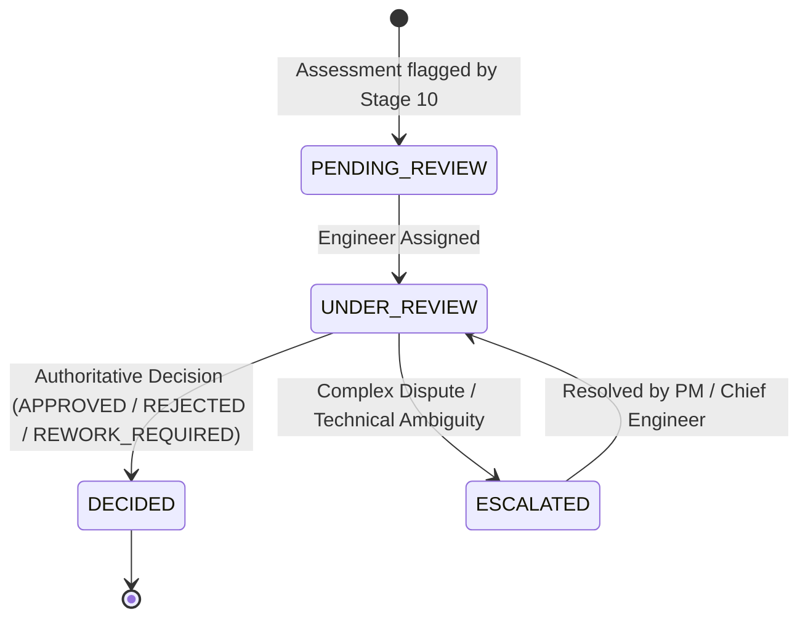

# InfraPulse AI — Stage 10 & 11 Human Review & Corrective Action Workflow

## 1. Executive Summary

Stages 10 and 11 bridge automated AI Computer Vision inference with authoritative engineering governance in the infrastructure construction lifecycle:
- **Stage 10 (AI Quality Inspection Engine)**: Evaluates multi-criteria inspection templates against Stage 9 visual detections, computes multi-dimensional evidence completeness, and generates an explainable compliance assessment.
- **Stage 11 (Human-in-the-Loop Review & Corrective Action Management)**: Provides an engineering review queue, an authoritative inspection workspace, rigorous **Rule 2 pre-validation**, physical measurement verification against engineering tolerances, vendor rework remediation enforcement, and automated **Stage 6 Dependency Release** propagation upon authoritative approval.

---

## 2. Stage 10: AI Quality Inspection Engine

### 2.1 Configurable Inspection Templates
Templates are mapped to specific infrastructure `WorkType`s (e.g., `TRENCHING`, `DUCT_INSTALLATION`, `FIBER_OPTIC_PULLING`, `BACKFILLING`, `ROAD_RESTORATION`):
- **Template Schema**:
  - `templateCode`: Unique code (e.g., `QIT-TRN-01`)
  - `workType`: Infrastructure work classification
  - `minPassingScore`: Threshold score required for automatic compliance consideration (typically 80.00–85.00)
  - `requiresHumanSignoff`: Boolean flag mandating human engineering approval regardless of score
  - `requiredEvidenceCategories`: Comma-separated list of mandatory evidence categories (e.g., `BEFORE_WORK,DURING_WORK,AFTER_WORK,DEPTH_MEASUREMENT`)

### 2.2 Inspection Criteria & Severity
Each template contains multiple criteria evaluated against Stage 9 detections:
- **Criterion Schema**:
  - `criterionCode`: E.g., `CRT-DPTH-01`
  - `name`: E.g., "Minimum Trench Depth Compliance"
  - `criticality`: `CRITICAL`, `MAJOR`, or `MINOR`
  - `weight`: Percentage contribution to the overall score (sum of weights = 100.00)
  - `targetValue`, `toleranceMin`, `toleranceMax`, `unit`: Engineering tolerance boundaries

### 2.3 Assessment Scoring Engine
For each work assignment inspection:
1. **Evidence Completeness Score**:
   $$\text{Completeness} = \frac{\text{Unique Submitted Required Categories}}{\text{Total Required Categories in Template}} \times 100$$
2. **Criteria Evaluation**:
   Each criterion is matched against AI inferences and visual detections. Criteria with confidence $\ge 0.70$ and measurement values within tolerance bounds are marked `PASSED`; otherwise `FAILED`.
3. **Overall Quality Score**:
   $$\text{Overall Score} = \sum_{\text{passed criteria}} \text{weight} \times \left(\frac{\text{Completeness}}{100}\right)$$
4. **Auto-Routing Logic**:
   - If `Overall Score` $\ge$ `minPassingScore`, zero `CRITICAL` criteria failed, completeness = 100%, and `requiresHumanSignoff` is `false`: Assessed as `PASSED`.
   - If any `CRITICAL` criterion fails, completeness $< 100\%$, or `requiresHumanSignoff` is `true`: Automatically provisions a `HumanInspectionReview` in `PENDING_REVIEW` state with priority assigned dynamically (`CRITICAL`, `HIGH`, `MEDIUM`, `LOW`).

---

## 3. Stage 11: Human-in-the-Loop Review Architecture

### 3.1 Human Review Lifecycle

### 3.2 Review Priority Determination
- `CRITICAL`: Overall score $< 50.00$ or failure on multiple `CRITICAL` safety/structural criteria (e.g., missing warning tape or dangerous depth shortfall).
- `HIGH`: Failure on a single `CRITICAL` criterion, or missing mandatory evidence.
- `MEDIUM`: Overall score $< 80.00$ with minor defects.
- `LOW`: Score $\ge 80.00$ awaiting mandatory signoff.

---

## 4. Authoritative Engineering Decisions & Rule 2 Engine

### 4.1 Authoritative Decision Types
An assigned Field Engineer, Project Manager, or Platform Admin can record decisions:
1. `APPROVED`: The infrastructure work strictly satisfies all engineering, safety, and visual specifications.
2. `REJECTED`: Work does not conform to specifications and cannot be remediated.
3. `REQUEST_MORE_EVIDENCE`: Visual evidence is inconclusive or insufficient.
4. `REWORK_REQUIRED`: Specific defects detected; vendor must remediate and resubmit proof.
5. `NEEDS_PHYSICAL_INSPECTION`: In-person on-site field verification required.
6. `ESCALATED`: Senior PM or Chief Engineer intervention required.

### 4.2 Rule 2 Pre-Validation Engine
To prevent erroneous or fraudulent approvals, the **Rule 2 Pre-Validation Engine** acts as a hard barrier on the backend (`HumanReviewService.java`) and frontend (`InspectionWorkspacePage.tsx`):
> **RULE 2**: An `APPROVED` decision is strictly **BLOCKED** if any of the following conditions are met:
> 1. Any mandatory or `CRITICAL` inspection criteria remain in `FAILED` status.
> 2. Any recorded physical measurement is `FAILED`, `UNVERIFIED`, or marked `SPECIFICATION_REQUIRED`.
> 3. Any Corrective Action rework notice is in `OPEN`, `VENDOR_SUBMITTED`, or `REJECTED` status.

Attempting to submit `APPROVED` when Rule 2 conditions are violated immediately throws HTTP 400 Bad Request with an explicit error list detailing each blocking reason.

### 4.3 Stage 6 Dependency Release Integration
When an authoritative `APPROVED` decision is committed:
1. `HumanInspectionReview.reviewStatus` transitions to `DECIDED`.
2. `QualityAssessment.assessmentStatus` transitions to `PASSED`.
3. `WorkAssignment.status` transitions to `COMPLETED`.
4. `WorkAssignment.releaseStatus` transitions to `RELEASED`.
5. **Downstream Unblocking**: `WorkDependencyEngine` automatically re-evaluates downstream work assignments in dependent zones. All dependent assignments whose prerequisites are now `RELEASED` are unblocked and transitioned to `ASSIGNED` or `AVAILABLE`.

---

## 5. Physical Measurements Verification Engine

Physical measurements provide quantitative verification of critical infrastructure dimensions:
- **Measurement Types**: `TRENCH_DEPTH`, `TRENCH_WIDTH`, `CABLE_SLACK`, `WARNING_TAPE_DEPTH`, `BEDDING_THICKNESS`, `CONCRETE_STRENGTH`, `OPTICAL_ATTENUATION`.
- **Engineering Tolerances**: `targetValue`, `toleranceMin`, `toleranceMax`, `unit`.
- **Missing Specification Handling**:
  - If target or tolerance values are not specified in the project engineering standard, the verification status is set to `SPECIFICATION_REQUIRED`.
  - **Critical Rule**: A measurement **NEVER** auto-passes when tolerances are absent. It must be explicitly resolved before an approval decision can be committed.

---

## 6. Corrective Actions Lifecycle & Vendor Restrictions

When non-conforming work or defects are identified, engineers issue formal **Corrective Action Rework Notices**:
- **Action Types**: `DEPTH_CORRECTION`, `TRENCH_WIDENING`, `BEDDING_REMEDY`, `WARNING_TAPE_INSTALLATION`, `CABLE_REROUTING`, `RE_COMPACTION`, `PHOTO_RETREAT`.
- **Vendor Restriction Enforcement**:
  - **Vendors CANNOT approve or close their own corrective actions.**
  - Vendors can only view their active rework notices (`/my-corrective-actions`) and upload remediation photographic evidence proofs (`/api/v1/corrective-actions/{id}/evidence`).
  - Submitting evidence transitions the action status to `VENDOR_SUBMITTED`.
  - Only authorized Field Engineers or Project Managers can verify the remediation evidence and commit a sign-off (`CLOSED` or `REJECTED`).

---

## 7. REST Endpoints Summary

### Human Reviews (`/api/v1/human-reviews`)
| Method | Endpoint | Description | Guard |
| :--- | :--- | :--- | :--- |
| `GET` | `/api/v1/human-reviews` | Filtered review queue with priority sorting & stats | `REVIEW_EVIDENCE` |
| `GET` | `/api/v1/human-reviews/{id}` | Complete inspection workspace detail | `REVIEW_EVIDENCE` |
| `POST`| `/api/v1/human-reviews/{id}/assign` | Assign reviewer to review | `REVIEW_EVIDENCE` |
| `POST`| `/api/v1/human-reviews/{id}/decisions` | Commit authoritative decision (enforces Rule 2) | `APPROVE_QUALITY_REVIEW` |
| `POST`| `/api/v1/human-reviews/{id}/escalate` | Escalate review with justification | `REVIEW_EVIDENCE` |

### Physical Measurements (`/api/v1/physical-measurements`)
| Method | Endpoint | Description | Guard |
| :--- | :--- | :--- | :--- |
| `GET` | `/api/v1/physical-measurements/assignment/{assignmentId}` | List measurements for assignment | `REVIEW_EVIDENCE` |
| `POST`| `/api/v1/physical-measurements` | Record physical measurement with tolerance check | `REVIEW_EVIDENCE` |
| `PUT` | `/api/v1/physical-measurements/{id}/verify` | Verify measurement status | `APPROVE_QUALITY_REVIEW` |

### Corrective Actions (`/api/v1/corrective-actions`)
| Method | Endpoint | Description | Guard |
| :--- | :--- | :--- | :--- |
| `GET` | `/api/v1/corrective-actions` | Filtered rework notices for engineers | `REVIEW_EVIDENCE` |
| `GET` | `/api/v1/corrective-actions/my-actions` | Vendor-restricted rework notices | `VIEW_ASSIGNED_WORK` |
| `POST`| `/api/v1/corrective-actions` | Issue new corrective action rework notice | `REVIEW_EVIDENCE` |
| `POST`| `/api/v1/corrective-actions/{id}/evidence` | Vendor submits rework proof | `SUBMIT_EVIDENCE` |
| `POST`| `/api/v1/corrective-actions/{id}/verify` | Engineer signs off / closes rework notice | `APPROVE_QUALITY_REVIEW` |
