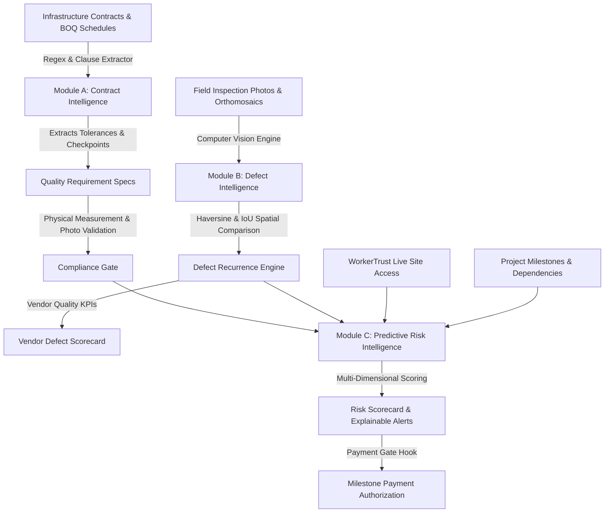

# InfraPulse Intelligence Suite
## Comprehensive Architecture & Engineering Reference
### Contract Intelligence + Defect Intelligence + Predictive Risk Intelligence

---

## 1. Executive Summary & Architectural Vision

The **InfraPulse Intelligence Suite** is a unified, enterprise-grade AI intelligence layer engineered for municipal corporations, public works departments, and large-scale infrastructure contractors. It transforms static legal contracts, unorganized drone/field photographs, and multi-vendor execution telemetry into active, traceable, and predictive project governance.

Rather than treating AI as an isolated chatbot or speculative score generator, the Intelligence Suite implements three connected, deterministic and explainable modules:

---

## 2. Module A — Contract Intelligence

### 2.1 Purpose & Capabilities
- **Document Ingestion**: Accepts contracts, BOQs, work orders, and technical specifications (`.txt`, `.pdf`, `.docx`).
- **Clause Extraction**: Extracts dimensional specifications, material grades, tolerance bounds, and hidden layer verification methods.
- **Physical Measurement Gate**: Automatically identifies hidden parameters (such as asphalt wearing course thickness, compaction density, concrete slump) that cannot be validated through photo evidence alone, enforcing `requires_physical_measurement: true` and calibrated field measurement recording.
- **Human Approval Workflow**: Extracted specifications enter `DRAFT` status and must be formally inspected, approved, or rejected by authorized Project Managers before enforcement.
- **Authorized Waivers**: Formal administrative workflow with engineering justification for technical waivers that creates an immutable audit trail.
- **Compliance Metrics**: Computes actual verified requirement percentages based on database state with zero hardcoded metrics.

### 2.2 Verification Methods Supported
| Method | Description | Applicable Domain |
|---|---|---|
| `PHYSICAL_MEASUREMENT` | Calibrated field gauge or core measurement | Asphalt thickness, Proctor density, trench depth |
| `PHOTO_EVIDENCE` | High-resolution visual inspection | Safety barricades, curb alignment, warning blinkers |
| `LAB_REPORT` | Certified third-party testing laboratory certificate | Concrete 28-day compressive strength, bitumen penetration |
| `DRONE_SURVEY` | Photogrammetric aerial elevation model | Camber crossfall, corridor slope drainage |

---

## 3. Module B — Defect Intelligence

### 3.1 Computer Vision & Classification
Module B classifies visual defects into standard civil engineering taxonomies:
1. `ROAD_CRACK`: Longitudinal, transverse, and alligator cracking.
2. `POTHOLE`: Depressions, raveling craters, and surface breakups.
3. `SURFACE_DETERIORATION`: Bleeding, rutting, and asphalt stripping.
4. `WATER_ACCUMULATION`: Inadequate camber crossfall causing ponding.
5. `INCOMPLETE_CONSTRUCTION`: Exposed rebar, unfinished curbs, unpaved utility cuts.
6. `MISSING_SAFETY_BARRIER`: Unprotected deep excavations, missing barricade netting.

### 3.2 Spatial & Visual Recurrence Engine
When a defect is recorded, the recurrence engine compares it against prior project defects:
- **Spatial Distance**: Haversine formula calculates real Euclidean surface distance between GPS coordinates.
- **Temporal Proximity**: Analyzes days elapsed between initial detection and subsequent inspections.
- **Category Congruence**: Prioritizes identical distress categories.
- **Bounding Box IoU**: Evaluates geometric overlap when co-located in the same image frame.
- **Threshold**: Similarity scores $\ge 0.70$ within 50 meters automatically flag recurring clusters and prompt human reviewer confirmation.

### 3.3 Defect Lifecycle States
$$\text{DETECTED} \longrightarrow \text{UNDER\_REVIEW} \longrightarrow \text{CONFIRMED} \longrightarrow \text{CORRECTIVE\_ACTION\_REQUIRED} \longrightarrow \text{REWORK\_SUBMITTED} \longrightarrow \text{REINSPECTION} \longrightarrow \text{RESOLVED}$$

### 3.4 Vendor Defect Scorecard
Tracks contractor performance metrics:
- **First-Pass Approval Rate**: $\frac{\text{Passed Inspections}}{\text{Total Inspections}} \times 100$
- **Defect Recurrence Rate**: $\frac{\text{Recurring Defects}}{\text{Total Defects}} \times 100$
- **Average Resolution Time**: Mean duration in days from detection to approved resolution.

---

## 4. Module C — Predictive Risk Intelligence

### 4.1 Multi-Dimensional Risk Engine
Evaluates real operational signals across five distinct project dimensions:

| Dimension | Operational Signal Sources | High/Critical Trigger Condition |
|---|---|---|
| **Schedule Risk (25%)** | `project_milestones`, `planned_end_date` | Milestone target delivery dates lapsed without payment approval |
| **Vendor Risk (25%)** | `corrective_actions`, `status = 'OPEN'` | Accumulating unclosed corrective actions $\ge 3$ items |
| **Quality Risk (25%)** | `infrastructure_defects`, `is_recurring` | Recurring defect clusters $\ge 2$ or unaddressed critical defects |
| **Resource Risk (15%)** | `work_assignments`, `worker_site_access` | Active assignments in progress with 0 verified workers checked in on site via WorkerTrust |
| **Dependency Risk (10%)** | `work_type_dependencies`, `assignments` | Successor work types scheduled before predecessor quality clearance |

### 4.2 Weighted Risk Scoring Model
$$\text{Overall Score} = 0.25 S_{\text{sched}} + 0.25 S_{\text{vend}} + 0.25 S_{\text{qual}} + 0.15 S_{\text{res}} + 0.10 S_{\text{dep}}$$
- $\text{Score} < 25.0 \implies \mathbf{LOW}$
- $25.0 \le \text{Score} < 50.0 \implies \mathbf{MEDIUM}$
- $50.0 \le \text{Score} < 75.0 \implies \mathbf{HIGH}$
- $\text{Score} \ge 75.0 \implies \mathbf{CRITICAL}$

### 4.3 Structured Explainability Schema
Every risk alert provides six transparent explainability cards:
1. **Problem Statement**: Plain-language description of the operational defect or delay.
2. **Supporting Evidence Data**: Exact data points (milestone codes, defect numbers, worker counts).
3. **Root Cause Reason**: Physical or organizational cause.
4. **Operational Impact**: Cascading delays, liquidated damages, traffic disruptions.
5. **Recommended Action**: Prescriptive, actionable mitigation step.
6. **Missing Data Notes**: Known data limitations and model assumptions.

---

## 5. Milestone Payment Gate Orchestration

The platform integrates directly into the finance milestone disbursement pipeline (`MilestoneEligibilityService.java`):

$$\mathbf{Milestone\ Eligibility} \iff \begin{cases} 
\text{Mandatory Contract Specifications} \in \{\text{VERIFIED}, \text{WAIVED}\} \\
\text{Physical Measurements} = \text{VERIFIED\_PASS} \\
\text{Active Critical Predictive Risk Alerts} = 0 \\
\text{Stage 11 Corrective Actions} = \text{CLOSED}
\end{cases}$$

If any critical alert is unaddressed or mandatory contract specification is pending verification, milestone payment authorization is strictly blocked.

---

## 6. Role-Based Access Control (RBAC) Matrix

| Platform Role | Contract Intelligence | Defect Intelligence | Predictive Risk | Payment Gate |
|---|:---:|:---:|:---:|:---:|
| **Platform Admin** | Full Manage / Approve | Full Manage / Confirm | Full Manage / Evaluate | Audit View |
| **Project Manager** | Full Manage / Approve | Review / Transition | Evaluate / Resolve | Review & Approve |
| **Vendor Contractor** | View Contracts / Reqs | View Assigned Defects | View Project Risks | View Milestone Status |
| **Field Engineer** | Record Measurements | Create / Inspect Defects | View Operational Risks | Validate Measurements |
| **Finance Officer** | View Compliance | View Vendor Scorecard | Inspect Risk Posture | Authorize Payment |

---

## 7. Database Migration Reference (`V15__intelligence_suite.sql`)

- Sequences: `contract_code_seq`, `requirement_code_seq`, `defect_code_seq`, `risk_assessment_seq`, `risk_alert_seq`.
- Tables:
  1. `project_contracts`: Contract headers, commercial terms, type, and contractor association.
  2. `contract_documents`: Uploaded contract documents with hash and extraction logs.
  3. `contract_requirements`: Extracted requirements, tolerances, and verification methods.
  4. `contract_requirement_evidence`: Links evidence to requirements with calibrated measurements.
  5. `infrastructure_defects`: Computer vision and manual defects with category and severity.
  6. `defect_similarity_candidates`: Spatial and visual recurrence candidates.
  7. `defect_history_events`: Audit trail for defect lifecycle status transitions.
  8. `project_risk_assessments`: Historical multi-dimensional risk scores.
  9. `project_risk_alerts`: Explainable risk alerts with resolution tracking.
