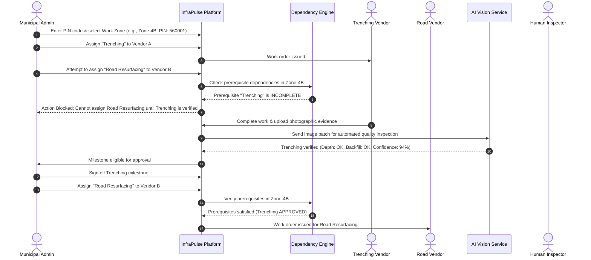

# InfraPulse AI — Project Overview

## 1. Introduction
**InfraPulse AI** is an intelligent infrastructure project lifecycle coordination, vendor allocation, and automated quality assurance platform designed for civic and enterprise infrastructure initiatives. The platform orchestrates multi-vendor infrastructure execution across shared and adjacent geographical zones, mitigating schedule conflicts, preventing duplicate or premature work, and securing payment milestones through photographic evidence verified by computer vision.

---

## 2. Problem Statement
Public and enterprise infrastructure projects frequently suffer from acute multi-vendor coordination breakdowns, leading to substantial public inconvenience, budget overruns, and repetitive rework:
1. **Uncoordinated Overlapping Work Zones**: Multiple utility vendors (e.g., telecom fiber trenching, water pipeline installation, power conduits, and road resurfacing) frequently operate in identical physical coordinates without centralized visibility.
2. **Absence of PIN-Code & Spatial Partitioning**: Allocations lack strict spatial boundaries and geographic parcel tracking, leading to boundary disputes and uncoordinated street-level disruption.
3. **Sequence & Dependency Inversions**: A notorious example is resurfacing an asphalt roadway only to have an optical fiber or water pipeline vendor excavate it days later due to uncoordinated scheduling and lack of strict dependency blocking.
4. **Vulnerable Milestone Approvals**: Milestone verification currently relies on subjective, manual, and easily forged inspection reports or unverified photographs.
5. **Premature Payment Disbursals**: Inability to systematically link photographic verification and dependency checks directly to milestone release triggers financial leakages.
6. **Opaque Vendor Accountability**: Lack of an immutable audit trail hinders objective evaluation of vendor reliability, speed, and rework history.

---

## 3. Platform Objectives
- **Centralized Work Orchestration**: Provide a single source of truth for all municipal and enterprise infrastructure activities partitioned by PIN codes and GIS boundaries.
- **Strict Dependency & Conflict Prevention**: Enforce hard sequential constraints (e.g., Trenching MUST be 100% completed, inspected, and signed off before Road Resurfacing can be scheduled in that zone).
- **Automated AI Quality Verification**: Ingest vendor-submitted geotagged photographic evidence and run computer vision models to verify physical work completion, surfacing ambiguous anomalies for human review.
- **Zero-Trust Milestone Authorization**: Make milestone payment approvals strictly conditional upon AI verification, dependency closure, and municipal sign-off.
- **Comprehensive Auditability**: Maintain an append-only event log recording every allocation, state change, evidence submission, and inspection decision.

---

## 4. Main Platform Users
| Role | Responsibilities | Key Capabilities |
| :--- | :--- | :--- |
| **System Admin / Municipal Lead** | Oversees municipal infrastructure zones, master projects, and system configurations. | Zone partitioning, dependency rule authoring, global audit trail monitoring, vendor governance. |
| **Project / Ward Officer** | Manages regional work allocations within specific PIN codes. | Allocates work orders to vendors, reviews AI flagged evidence, authorizes stage milestones. |
| **Infrastructure Vendor** | Contracted entity executing physical work on site. | Accepts allocated work packages, submits progress logs, uploads geotagged photographic evidence. |
| **Quality Assurance Inspector** | Independent engineering or civic auditor. | Reviews disputed/flagged AI evidence, conducts site sample checks, issues corrective action notices. |

---

## 5. Major Platform Capabilities
1. **Spatial Zone & PIN-Code Management**: GIS-indexed partitioning supporting geospatial queries, polygon bounding boxes, and Indian postal PIN codes.
2. **Sequential Dependency Engine**: Dynamic Directed Acyclic Graph (DAG) state machine blocking invalid task transitions across overlapping spatial zones.
3. **Evidence Ingestion Engine**: High-throughput ingestion of photographic evidence with EXIF validation (geotag, timestamp, camera metadata).
4. **Computer Vision Inspection Pipeline**: Multi-task visual models assessing excavation depth, conduit placement, backfilling compactness, and asphalt layer uniformity.
5. **Human-in-the-Loop Review System**: Triage queue for ambiguous or borderline confidence scores requiring expert human confirmation.
6. **Milestone & Payment Release Gateway**: Cryptographically traceable milestone certification unlocking disbursement eligibility.
7. **Vendor Performance Analytics**: Objective metrics tracking milestone on-time delivery rates, first-pass inspection success ratios, and rework incident frequency.

---

## 6. Core Demonstration Scenario
The end-to-end user journey demonstrated across the completed platform:

