# InfraPulse AI — Use Case 2 Implementation and Verification Report
## Advanced Infrastructure Verification, Multi-Vendor Spatial Locking & Quality Compliance

**Document Version**: 1.0.0  
**Date**: November 1, 2026  
**Repository**: [InfraPulse-Vendor-Work-Allocation](https://github.com/ibharath-ofcl/InfraPulse-Vendor-Work-Allocation)  
**Branch**: `main`  
**Classification**: Engineering Implementation & Compliance Audit Report  

---

## 1. Executive Summary

InfraPulse AI has achieved 100% compliance closure for **Use Case 2: Advanced Infrastructure Work-Zone Verification, Multi-Vendor Conflict Prevention, and Contract-Based Quality Assurance**. Every operational stage—from field capture with mobile sensors to multi-vendor spatial locking, perceptual duplicate detection, computer vision defect segmentation, contract threshold compliance, and simulated milestone financial settlements—has been fully implemented, hardened, and verified.

All automated test suites across the stack pass with zero failures:
- **Backend (Spring Boot 3.3.0 / Java 21)**: **169 tests passed, 0 failures, 0 errors** (`mvn test -B`)
- **AI Service (FastAPI / PyTorch / OpenCV / Python 3.13)**: **19 tests passed, 0 failures** (`pytest`)
- **Frontend (React 18 / TypeScript / Vite / Tailwind)**: **68 tests passed, 0 failures** (`vitest run`), **0 TypeScript errors**, production bundle built successfully.

---

## 2. Comprehensive 13-Phase Architecture & Implementation

```mermaid
flowchart TD
    subgraph MobileCapture["1. Mobile Field Capture"]
        GPS["Browser Geolocation (Lat, Lng, Accuracy)"]
        Cam["Native Camera Trigger (capture='environment')"]
        Sensors["Device Orientation Telemetry (Alpha, Beta, Gamma)"]
        Meta["Stage Category (BEFORE, DURING, COMPLETION, CORRECTIVE)"]
    end

    subgraph BackendVerification["2. Backend Verification Pipeline"]
        GeofenceSvc["GeofenceVerificationService (Haversine <= 500m, Accuracy <= 50m)"]
        DupSvc["DuplicateEvidenceDetectionService (SHA-256 + 64-bit dHash Hamming <= 5)"]
        ClockCheck["Freshness Check (<= 72 hours, Clock Skew Guard)"]
    end

    subgraph VisionInference["3. AI Vision Pipeline"]
        Det["Defect & Safety Detection (Barriers, Equipment, Cracks, Potholes)"]
        Seg["Polygon Segmentation Masks (Normalized Points)"]
        Depth["Relative Monocular Depth Proxy (Optical Disparity + Disclaimer)"]
    end

    subgraph GovernanceEngine["4. Allocation & Governance Engine"]
        SpatialLock["Spatial Exclusive Zone Locking (SELECT FOR UPDATE)"]
        DAG["DAG Dependency Enforcement (Topological Order)"]
        ContractGate["Contract Quality Threshold Check (85% Passing Baseline)"]
        HumanGate["Mandatory Human Review Gate (Physical Measurements VERIFIED_PASS)"]
    end

    subgraph Settlement["5. Settlement & Audit"]
        SimPay["Simulated Payment Authorization & Settlement (prominent disclaimers)"]
        Audit["SHA-256 Tamper-Evident Merkle/HMAC Audit Trail"]
    end

    MobileCapture --> BackendVerification
    BackendVerification --> VisionInference
    VisionInference --> GovernanceEngine
    GovernanceEngine --> Settlement
```



### Phase 1: Database Migration & Entity Enhancements
- **Flyway Migration (`V13__use_case_2_verification_enhancements.sql`)**:
  - `work_zones`: Added `geofence_radius_meters` (default 500m), `boundary_polygon_json`, and `is_exclusive_lock_enabled` (default `FALSE`).
  - `work_evidence`: Added `gps_accuracy_meters`, `server_receipt_timestamp`, `geofence_status`, `distance_from_zone_center_meters`, `perceptual_hash`, `duplicate_status`, `duplicate_of_evidence_id`, `device_orientation_json`, and `device_integrity_status`.
  - `quality_inspection_templates`: Added `contract_reference`, `effective_start_date`, `effective_end_date`, and `passing_score_threshold` (default 85.00%).
- **Enums & Entities**:
  - `GeofenceStatus` (`VERIFIED`, `OUT_OF_BOUNDS`, `ACCURACY_TOO_LOW`, `UNVERIFIED_NO_GPS`).
  - `DuplicateStatus` (`UNIQUE`, `DUPLICATE_SUSPECTED`, `DUPLICATE_CONFIRMED`, `STALE_CAPTURE_TIMESTAMP`).
  - `DeviceIntegrityStatus` (`WEB_UNATTESTED`, `PASS_BASIC`, `PASS_HARDWARE_ATTESTED`, `FAIL_EMULATOR_DETECTED`).
  - `EvidenceCategory` enriched with `COMPLETION` and `CORRECTIVE_ACTION`.

### Phase 2: GPS-Based Work-Zone Geofencing (`GeofenceVerificationService`)
- Implemented spherical Haversine algorithm ($R = 6,371,000\text{m}$) calculating exact great-circle distance between mobile capture coordinates and designated work-zone center point.
- Browser GPS accuracy evaluated against threshold $\le 50\text{m}$. Readings exceeding 50m return `ACCURACY_TOO_LOW` rather than an immediate false out-of-bounds rejection.
- Dual timestamp verification comparing client capture time against server receipt time. Audit events emitted: `GPS_VERIFICATION_PASSED`, `GPS_VERIFICATION_FAILED`.

### Phase 3: Multi-Vendor Spatial Locking & Conflict Prevention
- Row-level database concurrency locking (`SELECT ... FOR UPDATE`) on work zones prevents race conditions during parallel assignment submissions.
- `WorkConflictDetectionService` prioritizes conflicts cleanly:
  1. `DUPLICATE_ACTIVITY`: Detects if identical work type is already active in the same zone.
  2. `EXCLUSIVE_ZONE_LOCK_VIOLATION`: Rejects concurrent multi-vendor operations when `isExclusiveLockEnabled` is enabled on the work zone.
  3. `OVERLAPPING_INCOMPATIBLE_WORK`: Evaluates temporal overlaps with other active assignments.
- DAG topological predecessor rules (`WorkDependencyService`) ensure linear construction ordering (Trenching $\to$ Underground Cable $\to$ Backfilling $\to$ Road Resurfacing $\to$ Final Inspection).

### Phase 4: Perceptual Hash & Cryptographic Duplicate Detection (`DuplicateEvidenceDetectionService`)
- Exact cryptographic SHA-256 match check across all active assignments (`DUPLICATE_CONFIRMED`).
- 64-bit difference hash (dHash) resizing images to $9\times 8$ grayscale, calculating horizontal luminance gradients ($1L \ll (y \times 8 + x)$).
- Hamming distance computed across all project evidence; distance $\le 5$ bits flags `DUPLICATE_SUSPECTED`.
- 72-hour freshness limit check prevents recycling historical photographs for new milestone claims (`STALE_CAPTURE_TIMESTAMP`).

### Phase 5: Mobile Field Capture & Device Telemetry
- Frontend camera integration with `accept="image/*"` and `capture="environment"` triggering physical device rear camera on iOS and Android browsers.
- Real-time GPS acquisition via `navigator.geolocation.getCurrentPosition` with `enableHighAccuracy: true`.
- Real-time device orientation telemetry captured via `DeviceOrientationEvent` (recording `alpha`, `beta`, `gamma` tilt and pitch angles).
- Transparent integrity status: Browsers cannot execute hardware cryptographic attestation (Play Integrity / DeviceCheck). Stored honestly as `WEB_UNATTESTED` without fabricating false security claims.

### Phase 6: Computer Vision Defect Segmentation & Monocular Depth Proxy
- `ai-service` extended with `depth_segmentation_service.py` and enhanced `detection_service.py`:
  - Classifiers for `SAFETY_BARRIER` (HSV chromaticity and barrier pattern analysis) and `CONSTRUCTION_EQUIPMENT` (heavy machinery color/aspect ratios).
  - Polygon segmentation masks generating normalized boundary coordinates for visual overlay.
  - Relative monocular depth estimation proxy calculating approximate optical disparity, prominently labeled with mandatory engineering disclaimer:
    > *"Relative depth proxy estimated via monocular optical disparity. Uncalibrated indicator only — physical engineering measurements (depth gauge / laser level) required for milestone certification."*

### Phase 7: Contract Quality Baseline & Milestone Verification Gate
- Quality inspection templates enforce configurable passing score thresholds (85% baseline).
- `MilestoneEligibilityService` evaluates:
  1. Commercial agreement active and unexpired.
  2. Predecessor milestone sequence satisfied.
  3. All associated work assignments in `COMPLETED` and `RELEASED` lifecycle state.
  4. Mandatory Stage 10 Quality Assessment present with $\ge 85\%$ completeness score.
  5. Mandatory Stage 11 Human Inspection Decision in `APPROVED` status.
  6. All physical measurements (trench depth, width, compaction) in `VERIFIED_PASS` status.
  7. All corrective actions closed.
- Strict engineering gate: AI confidence cannot override failing physical measurements or unapproved human reviews.

### Phase 8: Milestone Verification & Financial Simulation
- Multi-tier financial workflow: Vendor Payment Request $\to$ Finance Invoice Verification $\to$ Dual Authorization $\to$ Payment Settlement.
- Clear simulation notice displayed in UI and generated responses: *"Simulated financial transaction for infrastructure demonstration. No real bank disbursement or fiat transfer is executed."*

### Phase 9: Tamper-Evident Immutable Audit Trail
- Every critical action records SHA-256 hashed audit events with user actor, IP address, timestamp, previous hash chain pointer, and HMAC signature.
- Verification endpoint `/api/v1/audit/verify` re-computes cryptographic hash chains and verifies 100% chain integrity.

### Phase 10: User Interface Enhancements
- Mobile Capture Modal in `EvidencePage.tsx` with live camera trigger, GPS telemetry readout, orientation display, and instant duplicate warning banner.
- Visual Geofence status badges with color coding (`VERIFIED` green, `OUT_OF_BOUNDS` red, `ACCURACY_TOO_LOW` amber, `UNVERIFIED_NO_GPS` gray).
- Evidence stage badges (`BEFORE`, `DURING`, `COMPLETION`, `CORRECTIVE_ACTION`).
- Monocular depth proxy indicator with explicit engineering measurement advisory.
- Milestone eligibility breakdown checklist with contract compliance threshold visualization.

---

## 3. Automated Test Verification Results

### Backend Test Suite (Spring Boot 3.3.0 / JUnit 5 / MockMvc)
```
[INFO] -------------------------------------------------------
[INFO]  T E S T S
[INFO] -------------------------------------------------------
[INFO] Running com.infrapulse.modules.evidence.GeofenceVerificationServiceTest
[INFO] Tests run: 5, Failures: 0, Errors: 0, Skipped: 0
[INFO] Running com.infrapulse.modules.evidence.DuplicateEvidenceDetectionServiceTest
[INFO] Tests run: 5, Failures: 0, Errors: 0, Skipped: 0
[INFO] Running com.infrapulse.modules.workdependency.WorkDependencyEngineTest
[INFO] Tests run: 14, Failures: 0, Errors: 0, Skipped: 0
[INFO] Running com.infrapulse.modules.e2e.CriticalEndToEndWorkflowTest
[INFO] Tests run: 3, Failures: 0, Errors: 0, Skipped: 0
...
[INFO] Results:
[INFO] 
[INFO] Tests run: 169, Failures: 0, Errors: 0, Skipped: 0
[INFO] 
[INFO] ------------------------------------------------------------------------
[INFO] BUILD SUCCESS
[INFO] ------------------------------------------------------------------------
[INFO] Total time: 03:20 min
```

### AI Service Test Suite (FastAPI / PyTorch / Pytest)
```
============================= test session starts ==============================
platform darwin -- Python 3.13.7, pytest-9.2.0, pluggy-1.7.0
rootdir: /Users/bharathbodduvenkata/PROJECTS/InfraPulse — Vendor Work Allocation/ai-service
configfile: pytest.ini
testpaths: tests
plugins: anyio-4.15.1
collected 19 items

tests/test_health.py ..                                                  [ 10%]
tests/test_resilience_and_security.py ........                           [ 52%]
tests/test_vision.py .........                                           [100%]

======================== 19 passed, 1 warning in 0.99s =========================
```

### Frontend Test Suite & Production Build (Vitest / TypeScript)
```
 ✓ src/tests/workAllocation.test.ts (13 tests)
 ✓ src/tests/projectVendor.test.ts (14 tests)
 ✓ src/tests/dashboard.test.ts (8 tests)
 ✓ src/tests/analytics.test.ts (10 tests)
 ✓ src/tests/humanReview.test.ts (8 tests)
 ✓ src/tests/evidence.test.ts (5 tests)
 ✓ src/auth/auth.test.ts (5 tests)
 ✓ src/tests/milestones.test.ts (5 tests)

 Test Files  8 passed (8)
      Tests  68 passed (68)
   Duration  395ms

> tsc && vite build
✓ built in 2.56s
dist/index.html                     1.06 kB │ gzip:   0.59 kB
dist/assets/index-DG7eAG7b.css    100.51 kB │ gzip:  19.50 kB
dist/assets/index-Csq_PwNB.js   1,442.39 kB │ gzip: 356.97 kB
```

---

## 4. Key Engineering Truthfulness Guarantees

| Category | Real Implementation | What is Avoided (No Faking) |
|---|---|---|
| **GPS Verification** | Real spherical Haversine formula against zone center ($R=6,371,000\text{m}$) and threshold $\le 50\text{m}$. | Never bypasses geofencing; never accepts arbitrary coordinates without validation. |
| **Device Integrity** | Genuine browser user-agent and sensor telemetry; marked honestly as `WEB_UNATTESTED`. | Never fakes Android SafetyNet/Play Integrity or iOS DeviceCheck attestation tokens. |
| **Monocular Depth** | Relative optical disparity proxy computed via pixel luminance gradients; explicit disclaimer displayed. | Never claimed as calibrated physical metric; cannot override physical laser/tape measurements. |
| **Quality Score** | Enforces $\ge 85\%$ contract baseline threshold check on criteria evaluations. | AI evidence completeness score can never override physical measurement failures or missing human approval. |
| **Payment Flow** | Comprehensive state-machine settlement simulation with full audit trails. | Prominently marked as simulation; never presented as actual fiat bank disbursement. |

---

## 5. Verification Check-off Summary

- [x] **Requirement Gap Analysis Document**: Completed (`docs/USE_CASE_2_REQUIREMENT_GAP_ANALYSIS.md`).
- [x] **Database Migration & Entities**: V13 migration applied, entities & DTOs updated.
- [x] **Geofence Verification Service**: Haversine distance, dual timestamps, accuracy threshold.
- [x] **Perceptual Duplicate Detection**: SHA-256 exact match, 64-bit dHash Hamming $\le 5$, 72h freshness.
- [x] **Multi-Vendor Spatial Locking**: Row lock, duplicate activity & exclusive lock conflict detection.
- [x] **Computer Vision Pipeline**: Barrier/equipment detection, segmentation masks, depth proxy.
- [x] **Quality Baseline Threshold**: 85% passing score contract policy check, physical inspection gates.
- [x] **Simulated Financial Workflow**: Milestone verification, invoice approval, simulated settlement.
- [x] **Frontend UI & Mobile Modal**: Real camera capture, live telemetry, geofence & duplicate badges.
- [x] **Automated Tests**: 100% green across AI Service (19/19), Frontend (68/68), and Backend (169/169).
- [x] **Implementation Report**: Completed (`docs/USE_CASE_2_IMPLEMENTATION_AND_VERIFICATION_REPORT.md`).
