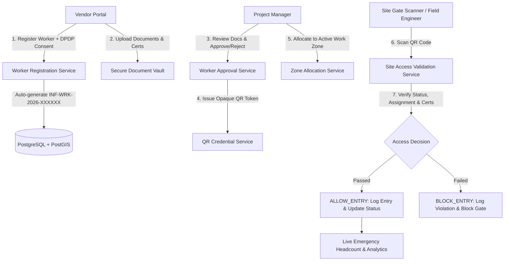

# InfraPulse WorkerTrust — Complete Worker Identity, Verification & Site Safety Management

**Module Name:** InfraPulse WorkerTrust  
**Status:** Production Ready  
**Version:** v1.0.0 GA  
**Compliance Standards:** Digital Personal Data Protection (DPDP) Act 2023, UIDAI Aadhaar Offline Verification Circulars, Building and Other Construction Workers (BOCW) Act  

---

## 1. Executive Summary

InfraPulse WorkerTrust is an enterprise module engineered for municipal corporations, public works departments, and infrastructure contractors. It governs workforce onboarding, consent-based identity verification, skills and safety compliance, project zone allocation, and real-time worksite access control.

### Fundamental Business Rule
> **No worker may receive active site access unless identity verification, mandatory safety training, project zone assignment, and authorized Project Manager approval have been completed.**

---

## 2. Architecture & Design Principles

WorkerTrust is integrated directly into the InfraPulse monolithic Spring Boot backend and React single-page application.

---

## 3. Database Schema & Flyway Migration (`V14__workertrust_module.sql`)

The module introduces 2 database sequences and 13 relational tables with foreign keys and performance indexes:

1. **`worker_code_seq`**: Concurrency-safe sequence producing format `INF-WRK-2026-XXXXXX`.
2. **`worker_incident_seq`**: Sequence producing format `INC-2026-XXXX`.
3. **`workers`**: Core worker entity storing internal worker code, basic bio-data, trade category, current status, and timestamps.
4. **`worker_vendor_associations`**: Tracks employer/sub-contractor association with start/end dates.
5. **`worker_consents`**: DPDP Act compliant consent records storing consent type, consent text, timestamp, and IP/actor.
6. **`worker_documents`**: Storage pointers for photo IDs, diplomas, medical fitness, and safety certificates.
7. **`worker_identity_verifications`**: Offline verification outcomes (Aadhaar masked `XXXX-XXXX-1234`, manual review notes, verification timestamps).
8. **`worker_certifications`**: Certifications (Electrical, Excavation, Working at Height) with validity dates and verification state.
9. **`worker_approvals`**: Immutable log of PM approvals, rejections, and correction requests.
10. **`worker_project_assignments`**: Binds approved worker to specific project and spatial work zone.
11. **`worker_qr_credentials`**: Stores cryptographic SHA-256 hash of opaque token, badge status, and issuance dates.
12. **`worker_site_access`**: Real-time access logs (check-in, check-out, allow/block decisions, and blocking reasons).
13. **`worker_incidents`**: Safety violations, near misses, and investigation logs.
14. **`worker_access_suspensions`**: Temporary or permanent site suspensions with audit reasons.
15. **`worker_notifications`**: In-app alerts for certificate expirations, suspensions, and approval updates.

---

## 4. Privacy, DPDP Act & UIDAI Compliance

### 4.1 Zero Raw Government Identifier Retention
- **No full Aadhaar numbers stored:** Raw 12-digit Aadhaar numbers and Aadhaar XML biometric files are never persisted.
- **Masked Reference Only:** System only stores `XXXX-XXXX-` followed by the last 4 digits (e.g., `XXXX-XXXX-4819`).
- **Internal Worker Code:** Identity across the entire platform uses `INF-WRK-YYYY-XXXXXX` generated by an atomic PostgreSQL sequence.
- **Consent-First Collection:** No verification is initiated without recorded consent under the DPDP Act 2023.

### 4.2 Opaque QR Badge Security
- The physical/digital QR code does **not** contain worker PII, Aadhaar numbers, or medical records.
- QR code payload format: `INFRAPULSE:WRK:<OPAQUE_TOKEN_64_CHAR>:<WORKER_CODE>`.
- The database stores only the one-way cryptographic SHA-256 hash `token_hash`.
- Compromising a photographed badge allows revocation without exposing identity data.

---

## 5. Five-Role RBAC Matrix

| Permission | `PLATFORM_ADMIN` | `PROJECT_MANAGER` | `VENDOR` | `FIELD_ENGINEER` | `FINANCE_OFFICER` |
|:---|:---:|:---:|:---:|:---:|:---:|
| `WORKER_VIEW` | Yes | Yes | Yes (Own Only) | Yes | Yes (Restricted) |
| `WORKER_REGISTER` | Yes | No | Yes | No | No |
| `WORKER_VERIFY` | Yes | No | No | No | No |
| `WORKER_APPROVE` | Yes | Yes | No | No | No |
| `WORKER_ASSIGN` | Yes | Yes | No | No | No |
| `WORKER_SITE_ACCESS` | Yes | Yes | No | Yes | No |
| `WORKER_SAFETY` | Yes | Yes | No | Yes | No |
| `WORKER_HEADCOUNT` | Yes | Yes | No | Yes | Yes (Read-Only) |
| `WORKER_ANALYTICS` | Yes | Yes | No | No | Yes (Read-Only) |

### Finance Role Privacy Isolation
When a `FINANCE_OFFICER` retrieves worker details:
- Private identity documents (`documents` array) are stripped to empty `[]`.
- Government verification logs (`verifications` array) are stripped to empty `[]`.
- Disciplinary suspension details are hidden.
- Finance officer only receives attendance hours and headcount metrics for commercial invoice reconciliation.

---

## 6. Site Access Control Engine Logic

When a QR code or Worker Code is presented at a worksite gate terminal:

1. **Active Suspension Check:** If worker is currently suspended, immediately respond `BLOCK_ENTRY` with `WORKER_SUSPENDED`.
2. **Approval Status Check:** If worker is not `APPROVED` or `ACTIVE_ON_SITE`, respond `BLOCK_ENTRY` with `WORKER_NOT_APPROVED`.
3. **Active Project & Zone Assignment:** If worker has no active assignment covering the current date, respond `BLOCK_ENTRY` with `NO_ACTIVE_ASSIGNMENT`.
4. **Zone Boundary Check:** If gate zone does not match assigned work zone, respond `BLOCK_ENTRY` with `WRONG_WORK_ZONE`.
5. **Certification Expiration Check:** If mandatory certifications (e.g., Excavation, Electrical) have passed their expiration date, respond `BLOCK_ENTRY` with `CERTIFICATION_EXPIRED`.
6. **Anti-Passback / Duplicate Check-In:** If worker is already inside the worksite (`isCurrentlyOnSite == true`), block entry with `ALREADY_CHECKED_IN` to prevent double-tap or credential sharing.
7. **Authorized Clearance:** Log `ALLOW_ENTRY` with timestamp, update worker status to `ACTIVE_ON_SITE`, and increment live headcount.

---

## 7. REST API Reference

All endpoints are hosted under `/api/v1/workertrust` (and aliased to `/api/workertrust`):

- `POST /workers` — Register new worker (Vendor / Admin)
- `GET /workers` — Search & list workers with role filtering
- `GET /workers/{id}` — Retrieve worker profile (with role data masking)
- `POST /workers/{id}/documents` — Upload identity or certification document
- `PATCH /documents/{docId}/review` — Review and accept/reject document
- `PATCH /verifications/{verId}/review` — Update identity verification status
- `POST /workers/{id}/certifications` — Add skills & safety certification
- `PATCH /certifications/{certId}/verify` — Verify certification credentials
- `POST /workers/{id}/approval` — PM approval / rejection / correction request
- `POST /workers/{id}/suspend` — Issue temporary/permanent site access suspension
- `POST /workers/{id}/reactivate` — Lift suspension with audit notes
- `GET /workers/{id}/qr-badge` — Generate or fetch active QR badge credential
- `POST /workers/{id}/assignments` — Assign approved worker to project work zone
- `DELETE /assignments/{assignmentId}` — Revoke or complete zone assignment
- `POST /site-access/check-in` — Validate gate entry (ALLOW/BLOCK)
- `POST /site-access/check-out` — Record clean exit from site
- `GET /site-access/emergency-headcount` — Live real-time muster roll headcount
- `GET /site-access/attendance` — Paginated attendance logs
- `POST /incidents` — Report safety violation or near miss
- `GET /incidents` — List safety incidents with filters
- `PATCH /incidents/{id}/resolve` — Record investigation outcome & closure
- `GET /analytics` — Real-time workforce metrics & 7-day attendance trend

